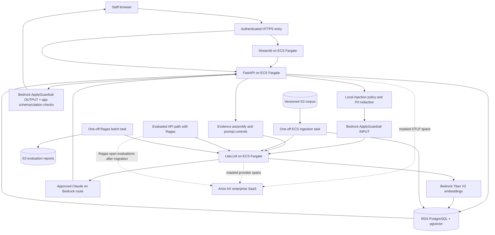

# NexaAssist on AWS — Bedrock deployment design

For the requested **short-lived training sessions**, the implemented path is
[the disposable AWS lab](../../infra/aws/README.md). It uses one Docker host and
automatic teardown to match the 1–2 hour, $3–$8 allowance. The persistent managed
architecture below remains a separate, unimplemented design.

Implementation update, **31 October 2026**: the lab now includes
`app/gateway/litellm_bedrock.yaml`, optional fail-closed Bedrock input/output
checks, CloudFormation and GitHub Actions. Its Phoenix-based tracing and
single-host lifecycle differ from the Arize/ECS target below. No live AWS
compatibility or deployment result is claimed by this implementation.

Updated **28 October 2026** against the current repository and the linked vendor documentation. This is an implementation plan, not a deployed or benchmarked AWS stack. The current local Compose configuration still uses Ollama for chat and embeddings and self-hosted Phoenix for local tracing.

The proposed deployment uses **Anthropic Claude on Amazon Bedrock** for chat and **Amazon Titan Text Embeddings V2** for embeddings. Choose a Claude model or inference profile available to the target AWS account and Region, then verify the application's strict structured-output contract before deployment. This is a design choice, not a route in the current gateway YAML. [Claude on Bedrock](https://docs.aws.amazon.com/bedrock/latest/userguide/service_code_examples_bedrock-runtime_anthropic_claude.html), [model availability](https://docs.aws.amazon.com/bedrock/latest/userguide/models.html).

## Recommended responsibility split

| Concern | AWS design | Why |
| --- | --- | --- |
| Chat and evaluation judge | Approved Amazon Bedrock model routes behind LiteLLM | Managed inference while preserving the application's OpenAI-compatible gateway client |
| Corpus and evaluation embeddings | Amazon Titan Text Embeddings V2 through LiteLLM | Managed embeddings; use a new corpus identity and re-ingest |
| Inline safety | Existing application checks plus **Amazon Bedrock Guardrails** | Enforce configured prompt-attack, sensitive-data and output policies |
| Tracing and result inspection | **Arize AX enterprise SaaS** | Receive API/gateway OpenInference spans in an enterprise space and project; no Phoenix service or telemetry database in AWS |
| Answer quality | **Ragas**, published as Arize AX span evaluations after adapter migration | Measure faithfulness, relevancy, context precision and recall using a fixed judge/profile |
| Retrieval and state | RDS PostgreSQL with pgvector | Keep the application's dense retrieval and policy/feedback storage |

**Arize AX observes decisions; it does not block a request merely because a trace arrived.** Bedrock Guardrails can block or mask configured content, while the application must still enforce its Pydantic schema, evidence IDs, exact quotes, product/date scope and abstention policy. [Bedrock Guardrails](https://docs.aws.amazon.com/bedrock/latest/userguide/guardrails.html).

## Target request flow



This is the persistent deployment **target**. The answer, evaluated-answer and batch-evaluation entry points call `scrub_request` before generation, retrieval and judging; retrieval scrubs again. The lab's optional Bedrock input check runs on that sanitized query before embedding, and its output check runs at the shared draft-validation boundary. Dedicated guardrail-decision spans and assembled-prompt scanning remain future work. To inspect instructions hidden in retrieved evidence, also check the assembled prompt or attach a compatible guardrail at model invocation. Bedrock's independent `ApplyGuardrail` API supports both `INPUT` and `OUTPUT` assessments without tying the check to a model invocation. [ApplyGuardrail](https://docs.aws.amazon.com/bedrock/latest/userguide/guardrails-use-independent-api.html).

## AWS service placement

| Component | Placement | Access |
| --- | --- | --- |
| FastAPI and Streamlit | ECS Fargate services, existing application image | Authenticated HTTPS entry; private service links |
| LiteLLM | ECS Fargate, existing gateway image with a **new Bedrock YAML** | Private; task IAM role invokes approved Bedrock models |
| Chat, judge and embeddings | Amazon Bedrock in an approved Region | Bedrock Runtime through scoped IAM and, where chosen, a VPC interface endpoint |
| Bedrock Guardrails | Managed Bedrock guardrail and version | App task role calls `ApplyGuardrail`; apply approved policy to input and output |
| Ragas | Existing evaluated API path and one-off ECS evaluation task | Fixed judge, embedding and golden-dataset identities |
| Arize AX enterprise | Arize-managed SaaS outside the application VPC | Authenticated enterprise space/project; approved outbound TLS OTLP from API and gateway tasks |
| Application vectors and feedback | RDS PostgreSQL with pgvector | Private, backed up, separate runtime/provisioning roles |
| Policy documents and evaluation reports | Private, versioned S3 locations | Explicit stage-in/stage-out jobs; no implicit `s3://` CLI support |
| Gateway master key, Arize API key and database password | AWS Secrets Manager | Inject only into tasks that use them; keep Arize space ID and project name explicit |

Arize AX accepts OpenInference/OTLP traces with a space ID and API key. Obtain the endpoint and data residency from the enterprise tenant, then allow approved outbound TLS from private ECS tasks through the organization's egress path. Keep input/output masking enabled before export; do not assume the local Phoenix exporter can authenticate to Arize AX. [Arize AX tracing setup](https://arize.com/docs/ax/quickstarts), [masking](https://arize.com/docs/ax/observe/tracing/configure/masking-span-attributes), [network allowlist](https://arize.com/docs/ax/reference/authentication-and-security/whitelisting). Select an RDS engine version that supports the required `vector` extension. [RDS extension versions](https://docs.aws.amazon.com/AmazonRDS/latest/PostgreSQLReleaseNotes/postgresql-extensions.html).

For the planned API exporter, use `arize.otel.register` with the enterprise space ID, API key, project name and tenant-approved endpoint, then attach the existing FastAPI/LangChain instrumentors with private-content masking. For the gateway, use LiteLLM's `arize` OTel v2 callback and `no_content` message capture. The current `app.phoenix_main` registration and `app.evaluation.phoenix_export` client target Phoenix APIs; they cannot be repointed by changing only a URL. After Ragas scoring, publish scored metrics to the matching Arize AX API span using `ArizeClient.spans.update_evaluations` and its required `context.span_id`, `eval.<name>.label`, `eval.<name>.score` and `eval.<name>.explanation` columns. Preserve `unavailable`/error statuses in the API response and safe trace metadata instead of inventing scores. [Arize OTel registration](https://arize.com/docs/ax/integrations/opentelemetry/opentelemetry-arize-otel), [Arize span evaluations](https://arize.com/docs/ax/evaluate/run-evals-on-traces), [LiteLLM Arize callback](https://docs.litellm.ai/docs/observability/opentelemetry_v2).

Amazon Bedrock documents interface VPC endpoints, including `bedrock-runtime`. Private DNS can route the standard Regional hostname through the endpoint; endpoint policy, security groups and IAM must still be configured. [Bedrock VPC endpoints](https://docs.aws.amazon.com/bedrock/latest/userguide/vpc-interface-endpoints.html). Use an ALB certificate and a suitable enterprise authentication layer for staff-facing entry. [ALB HTTPS listener](https://docs.aws.amazon.com/elasticloadbalancing/latest/application/create-https-listener.html).

## Bedrock model selection and corpus migration

1. Choose an approved **chat** model/inference profile in the target Region. A Llama route is a candidate only if account access, API support and the application's strict structured-output contract all pass. The app calls `with_structured_output(AnswerDraft, method="json_schema", strict=True)`; a generic text response is insufficient. Also verify the chosen judge route's structured output. [Bedrock model catalog](https://docs.aws.amazon.com/bedrock/latest/userguide/model-cards.html).
2. Use `amazon.titan-embed-text-v2:0` as the proposed embedding model. Its default vector length is **1024**; Bedrock also offers 512/256. The current custom-endpoint client checks the returned length but does not send a `dimensions` parameter, so the default 1024-vector route is the smallest fit. [Titan Text Embeddings V2](https://docs.aws.amazon.com/bedrock/latest/userguide/titan-embedding-models.html).
3. Create **new chunk and parent namespaces** and a new immutable `EMBEDDING_PROFILE`; ingest all corpus documents again. Qwen and Titan vectors are incompatible even when both have 1024 dimensions. The pgvector store records model, dimensions and profile per namespace and rejects identity changes.
4. Keep one judge/embedding evaluation profile fixed when comparing releases. Point existing `EVAL_JUDGE_*` and `EVAL_EMBEDDING_*` settings to explicit gateway aliases. Do not silently leave the evaluator on OpenAI when measuring an AWS-only deployment.
5. Disable the Ollama reranker unless a compatible replacement is separately implemented and tested. The current dense pgvector retrieval works without it.

LiteLLM documents Bedrock chat and embeddings, including provider routing with `bedrock/converse/<model-or-profile>` and IAM credential handling through boto3. [LiteLLM Bedrock provider](https://docs.litellm.ai/docs/providers/bedrock). The repository pins LiteLLM **1.106.2**; check that image's exact Bedrock, structured-output, tracing and guardrail behavior before adopting a current documentation example. An ECS **task role** is preferred over static AWS access keys.

The following is an **illustrative fragment for a new gateway YAML**, not the current runnable configuration. The two model-route environment values must be concrete, qualified Bedrock identifiers supported by the chosen account, Region, LiteLLM version and API method:

```yaml
model_list:
  - model_name: nexa-chat-bedrock
    litellm_params:
      model: os.environ/BEDROCK_CHAT_ROUTE
      aws_region_name: os.environ/AWS_REGION_NAME
  - model_name: nexa-judge-bedrock
    litellm_params:
      model: os.environ/BEDROCK_JUDGE_ROUTE
      aws_region_name: os.environ/AWS_REGION_NAME
  - model_name: nexa-embed-bedrock
    litellm_params:
      model: bedrock/amazon.titan-embed-text-v2:0
      aws_region_name: os.environ/AWS_REGION_NAME
```

Replace the gateway's `arize_phoenix` callback with `arize` and retain master-key authentication. The LiteLLM OTel v2 Arize preset requires `ARIZE_SPACE_ID` and `ARIZE_API_KEY`; set an explicit `ARIZE_PROJECT_NAME` and preserve `no_content` capture. Verify the pinned LiteLLM image supports these settings before release. If chat and judge use the same underlying model, keep separate aliases so their identity and evaluation settings remain explicit. OpenAI may remain an **approved optional fallback**; it is not required for this Bedrock-only target. [LiteLLM OTel v2 destinations](https://docs.litellm.ai/docs/observability/opentelemetry_v2).

## Deployment order

1. **Network and identity.** Create private task/database subnets, staff HTTPS entry and approved outbound TLS access to the enterprise Arize endpoint. Create only the VPC endpoints required by the selected Bedrock APIs and other AWS services. Scope the API task role to the guardrail/version and the gateway role to the approved model or inference-profile resources. Confirm model access, quotas, endpoint policies and Region. Service Connect names must be configured explicitly. [ECS Service Connect](https://docs.aws.amazon.com/AmazonECS/latest/developerguide/service-connect.html).
2. **Release images.** Publish immutable API/UI, gateway and current validator images to ECR from the existing [application Dockerfile](../Dockerfile), [gateway Dockerfile](../gateway/Dockerfile) and [validator Dockerfile](../security/Dockerfile). Match the task CPU architecture. The current gateway image includes `/opt/gateway/litellm.yaml`; the Compose `active.yaml` path exists only through a bind mount. Package and select the new Bedrock YAML explicitly.
3. **Durable database.** Create the application RDS PostgreSQL database with pgvector, backups and restore checks. Arize AX owns its SaaS telemetry storage; do not provision a Phoenix database. Run application provisioning once with extension/schema privileges:

   ```bash
   python -m app.database.postgres init
   ```

   Use a less-privileged runtime account afterward.
4. **Secrets and routes.** Deliver the gateway master key, database password and Arize AX API key through scoped Secrets Manager entries. Injected environment secrets are refreshed by replacing tasks after rotation. Configure an enterprise Arize space ID, separate API/gateway project names and the tenant-approved OTLP endpoint. [ECS Secrets Manager integration](https://docs.aws.amazon.com/AmazonECS/latest/developerguide/secrets-envvar-secrets-manager.html). The gateway authenticates the app; the gateway's AWS identity comes from its task role.
5. **Guardrails implementation.** Define and version the Bedrock guardrail. Test its configured prompt-attack and sensitive-data policies on synthetic inputs. Keep the app's PAN/Aadhaar/email masking and exact output checks; do not assume all local identifiers are covered by built-in Bedrock PII categories. Add fail-closed `ApplyGuardrail` handling at the shared request/output boundaries and trace only a safe decision label, policy version and correlation ID. Keep the existing Guardrails AI sidecar until the replacement passes the same acceptance cases. [Bedrock Guardrails](https://docs.aws.amazon.com/bedrock/latest/userguide/guardrails.html), [ApplyGuardrail](https://docs.aws.amazon.com/bedrock/latest/userguide/guardrails-use-independent-api.html).
6. **Corpus migration and service startup.** Stage the versioned S3 document register and its relative files into a one-off ECS ingestion task, then run:

   ```bash
   python -m app.services.ingestion /data/document_register.json
   ```

   The command currently reads a local path, not `s3://`. Start gateway and API/UI against the new profile and namespaces; verify Arize AX ingestion separately. Preserve the current app/gateway auth distinction described below.
7. **Smoke, evaluate, release.** Check `/health`, `/ready`, scoped `/retrieve`, `/answer` and `/answer/evaluated`. After the tracing migration, use the returned trace/span IDs to find the API request in the Arize AX project, then inspect gateway model attributes in its project and the Ragas scores attached to the API span. The current response fields still say `phoenix_trace_id`/`phoenix_span_id`; rename them in a versioned API change or document that they hold generic OTel IDs. A successful HTTP response alone is not a policy-quality pass. Run batch evaluation with the fixed judge/profile and stage the JSON report to S3 before the task exits:

   ```bash
   python -m app.evaluation.run --dataset app/evaluation/datasets/answer.jsonl --gates app/evaluation/gates.json --output /tmp/nexa-evaluation.json
   ```

   The current batch CLI does not automatically upload that file or attach Arize AX evaluations. Its output gates are placeholders until calibrated against a measured Bedrock baseline.

## Configuration changes required before the target can run

The current [LiteLLM YAML](../gateway/litellm.yaml) routes chat/embeddings to Ollama and requires an OpenAI fallback. The [Compose file](../compose.yaml) also supplies local Ollama endpoints and OpenAI credentials. Changing only `.env` cannot turn that deployment into the diagram above. Create and test a new gateway YAML and ECS task configuration; do not repoint the existing Qwen alias at Titan while retaining its old profile.

Illustrative **API task settings after the new aliases and guardrail calls exist**:

```dotenv
STORAGE_BACKEND=pgvector
CHAT_MODEL=nexa-chat-bedrock
CHAT_API_MODE=chat_completions
CHAT_BASE_URL=http://gateway:4000/v1
EMBEDDING_MODEL=nexa-embed-bedrock
EMBEDDING_BASE_URL=http://gateway:4000/v1
EMBEDDING_DIMENSIONS=1024
EMBEDDING_PROFILE=titan-v2-1024-v1
MONGODB_COLLECTION=nexa_chunks_titan_v2
MONGODB_PARENT_COLLECTION=nexa_parents_titan_v2
RETRIEVAL_MODE=dense
RERANK_ENABLED=false
EVAL_JUDGE_MODEL=nexa-judge-bedrock
EVAL_JUDGE_API_MODE=chat_completions
EVAL_JUDGE_BASE_URL=http://gateway:4000/v1
EVAL_EMBEDDING_MODEL=nexa-embed-bedrock
EVAL_EMBEDDING_BASE_URL=http://gateway:4000/v1
EVAL_EMBEDDING_DIMENSIONS=1024
EVAL_EMBEDDING_PROFILE=titan-v2-1024-v1
ARIZE_SPACE_ID=<enterprise-space-id>
ARIZE_PROJECT_NAME=nexaassist-api
ARIZE_API_KEY=<injected-from-Secrets-Manager>
OPENINFERENCE_HIDE_INPUTS=true
OPENINFERENCE_HIDE_OUTPUTS=true
OTEL_SDK_DISABLED=false
```

Also supply the existing institution/jurisdiction/confidentiality fields and scoped `POSTGRES_DSN`. Set `CHAT_API_KEY`, `EMBEDDING_API_KEY`, `EVAL_JUDGE_API_KEY` and `EVAL_EMBEDDING_API_KEY` from the **gateway master key secret**; a custom gateway endpoint requires an explicit key in this app. The `ARIZE_*` and `OPENINFERENCE_*` lines are target settings: the current `app.phoenix_main` does not consume them as an Arize AX exporter. Replace that registration with `arize-otel`, preserve private-content masking, and replace `app.evaluation.phoenix_export` with Arize AX span-evaluation publishing. Set gateway `LITELLM_MASTER_KEY`, `AWS_REGION_NAME`, Bedrock route values, `ARIZE_SPACE_ID`, `ARIZE_API_KEY`, `ARIZE_PROJECT_NAME=nexaassist-gateway` and `LITELLM_OTEL_V2=true` in its task; use `callbacks: ["arize"]` in the new gateway YAML. Use the tenant-approved Arize endpoint and approved egress, especially for a non-US enterprise space. Remove application and gateway OpenAI fallback routes for a Bedrock-only rollout. Clear Qwen's `CHAT_REASONING_EFFORT=none` if unsupported by the chosen Bedrock route. Give the API task role `ApplyGuardrail` access only after that integration is implemented. No static `AWS_ACCESS_KEY_ID` or `AWS_SECRET_ACCESS_KEY` is needed for ECS task-role access. [Arize OTel setup](https://arize.com/docs/ax/observe/tracing-integrations-auto/opentelemetry-integrations-for-arize/opentelemetry-arize-otel), [LiteLLM Arize preset](https://docs.litellm.ai/docs/observability/opentelemetry_v2).

Do not treat these settings as a complete ECS task definition. Arize AX instrumentation/evaluation publishing and ECS provisioning remain unimplemented. The separate lab provides Bedrock Guardrails settings/SDK calls, a Bedrock gateway file and S3 corpus/report transfer. Bedrock model access and IAM policies still require validation against the selected account, Region and model resource types.

## Code map and acceptance checks

| Code path and line | Today | Bedrock migration check |
| --- | --- | --- |
| [Gateway YAML](../gateway/litellm.yaml), line 1 | Defines Qwen/Ollama and OpenAI aliases with a Phoenix callback | Add new Bedrock chat, judge and Titan aliases; use the Arize AX `arize` callback |
| [Chat client](../chains/llm.py), line 14 | Calls OpenAI-compatible gateway | Verify chosen Bedrock route returns strict schema through this path |
| [Embedding client](../chains/embeddings.py), line 44 | Checks vector length/profile for custom endpoint | Verify Titan route returns 1024 finite values for ingestion and query |
| [Corpus identity](../database/postgres.py), line 46 | Rejects profile mismatch | Create new chunk/parent namespaces and re-ingest |
| [Input policy](../services/retrieval.py), line 23 | Supplies local prompt policy and PII redaction; answer/evaluation entry points use it before generation too | Preserve all current call sites; add fail-closed Bedrock INPUT check before external calls |
| [Answer entry](../services/answer.py), line 38 | Scrubs the query before invoking the answer chain | Preserve the sanitized query when adding Bedrock checks |
| [Answer chain](../chains/answer.py), line 97 | Strict `AnswerDraft`, PII, citations and abstention | Add output guardrail handling without weakening existing checks |
| [API tracing](../phoenix_main.py), line 29 | Exports API spans to Phoenix with private-content default | Register Arize AX exporter, retain masking and correlation, record safe guardrail decision metadata |
| [Ragas profiles](../evaluation/profiles.py), line 6 | Separates candidate and evaluator routes | Pin Bedrock judge/embedding aliases |
| [Evaluation export](../evaluation/phoenix_export.py), line 55 | Publishes Ragas metric annotations to Phoenix | Replace with Arize AX span evaluations keyed by the matching span ID; verify score/status display |

Use a synthetic loan-policy request for the release demonstration:

```json
{
  "query": "What is the maximum NexaHome loan amount?",
  "as_of": "2026-10-01",
  "product_id": "NEXA-HL",
  "top_k": 5
}
```

The expected policy fact is ₹7,50,00,000. Acceptance requires an `answered` status, a valid clause citation, the correct model/profile in the trace and available evaluation scores; if any of those are absent, inspect retrieval, structured output, guardrail outcome and evaluator separately. For a PII example, add a synthetic email and PAN to the query and confirm the sanitized query reaches embedding, with no raw PII in exported spans. For an injection example, include an explicit instruction override and confirm the shared input boundary blocks it before retrieval. A Bedrock guardrail block should produce a safe API response and a decision span, not a leaked prompt or successful answer.

## Operational drills and limits

| Scenario | Where to inspect | Recovery criterion |
| --- | --- | --- |
| Bedrock model access denied, quota or throttling | Gateway error, Bedrock status, API/gateway Arize AX spans | Controlled error or approved alternate route; no fabricated answer |
| Guardrail blocks or service unavailable | API decision/error span and guardrail version | Policy enforced, no silent bypass; PII stays out of logs/traces |
| Empty/wrong pgvector corpus | New namespace/profile, ingestion result and `/retrieve` | Re-ingest compatible vectors and verify scoped evidence |
| Strict schema or citation failure | API result and model span, [answer chain](../chains/answer.py) | Safe abstention or explicit failure, never uncited policy claims |
| Missing Arize AX spans/evaluations | Space ID, API key, tenant endpoint, egress, project/time range and publisher logs | Restore export; do not infer absence of inference from absence of traces |
| Secret rotation | ECS task revision and gateway/database auth | Replace tasks to load current injected values |

Arize AX tracing does not provide an authorization boundary, durable evaluation queue, guaranteed prompt-attack detection or a proof of grounding. Ragas grades are model-based evidence, so calibrate them with the golden dataset and human review. The current API evaluation exporter uses an in-process task; production durability needs a separately implemented queue/workflow if required. The [AWS Bedrock training deck](../presentations/NexaAssist_AWS_Bedrock_20261027/README.md) predates this Arize AX decision and depicts self-hosted Phoenix. This persistent design has no live AWS deployment, Bedrock compatibility test, paid model call or performance benchmark. The disposable lab's implementation and offline checks are recorded separately.

See the [interactive AWS, Claude and Arize AX architecture](../../.archify/architecture-nexaassist-arize-saas-20261028-064322/nexaassist-aws-arize-ax.html) and its [source map](../../.archify/architecture-nexaassist-arize-saas-20261028-064322/SOURCE_EVIDENCE.md).
