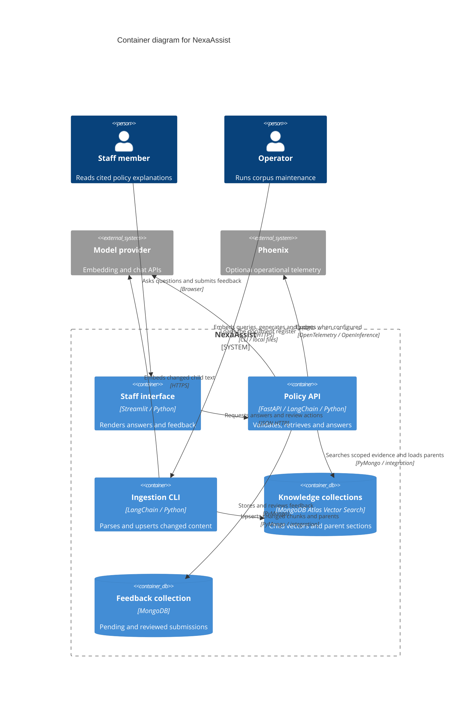

# Container view — NexaAssist

Logical runtime and persistence view of the current working copy. A C4 container is a running application or data store; LangChain and service modules run inside the API/CLI and are not separate deployable services.

The collections are logical stores in the configured database, not a claim that each is a separate database server. The ingestion CLI is a separate process. API services/chains are internal components. Optional hybrid search and reranking are configuration branches. Conversation persistence, automatic dataset promotion, semantic cache and blue/green promotion are not implemented by this training revision.

Code evidence: `app/main.py`, `app/ui/app.py:19`, `app/services/answer.py:21`, `app/services/retrieval.py:33`, `app/services/retrieval.py:65`, `app/chains/ingestion.py:38`, `app/database/mongo.py`, `app/database/feedback.py` and `app/services/evaluation.py`.

The API now exposes authenticated reviewer-curated golden export. The service reads accepted institution-scoped feedback and returns a strict case plus audit metadata. The Streamlit reviewer form offers JSONL and review-bundle downloads. No application server writes the golden dataset.
