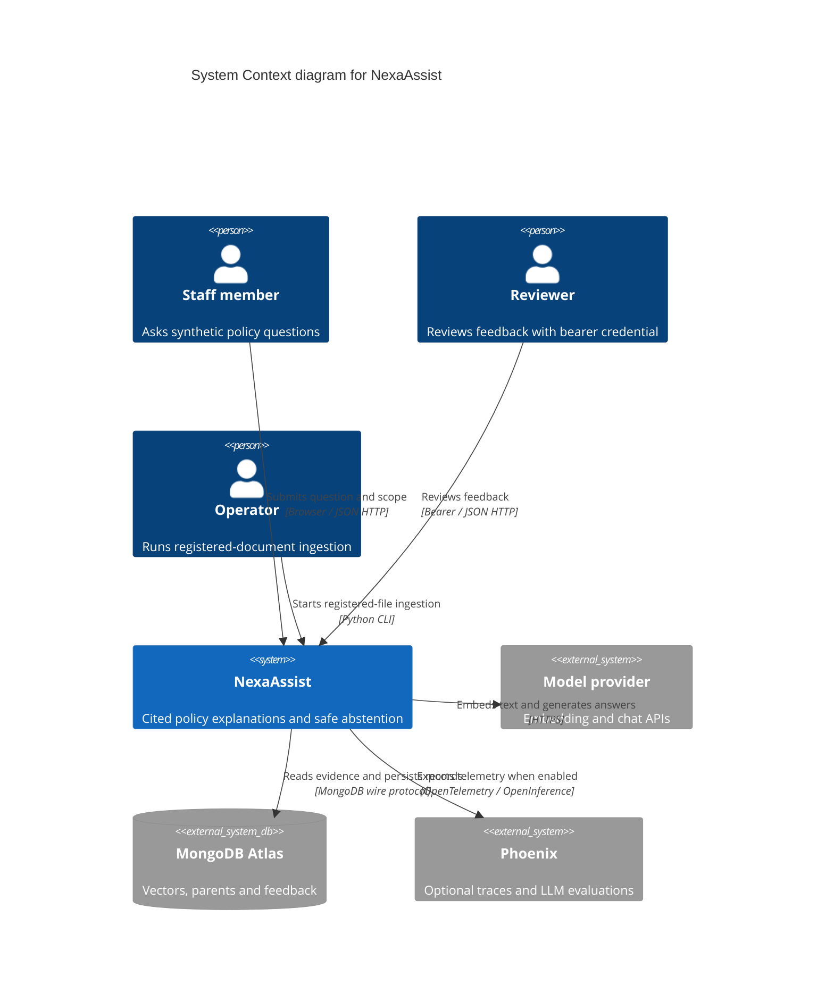

# System context — NexaAssist

Current training implementation, inspected 2026-10-23. The folder has no Git metadata, so this is a working-copy view, not a commit-pinned architecture. The source course's support assistant is adapted to synthetic banking policy.

Evidence: `app/ui/app.py`, `app/api/answer.py`, `app/api/auth.py`, `app/services/ingestion.py`, `app/chains/llm.py`, `app/chains/embeddings.py`, `app/database/mongo.py`, `app/database/feedback.py`, `app/phoenix_main.py`, `app/services/evaluation.py`.

The app does not execute credit decisions. Phoenix is conditional; live dependencies were not exercised. End-user identity, authorization and production deployment controls need a separate design decision. Context-view external services are black boxes; these are not additional in-process modules.
