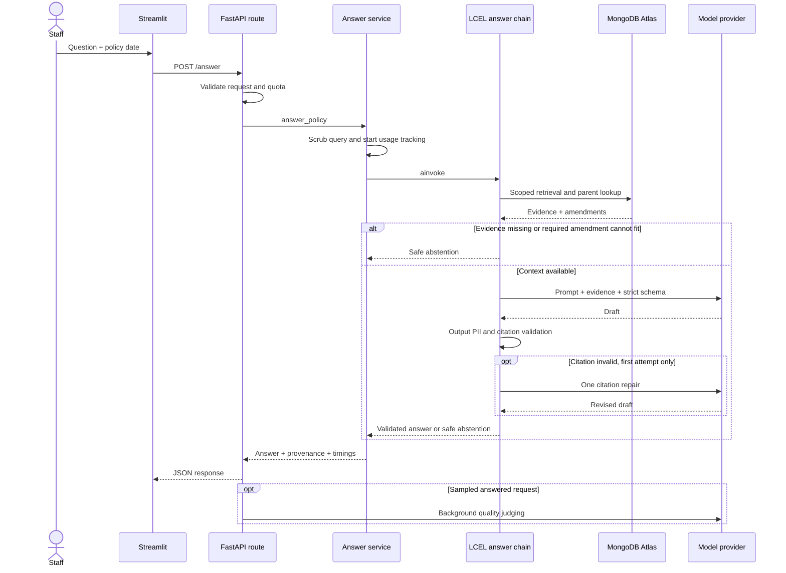

# Dynamic view — answer lifecycle

Evidence: `app/api/answer.py`, `app/services/answer.py`, `app/chains/answer.py`, `app/services/retrieval.py` and `app/services/evaluation.py`. The real chain returns a fixed clarification when scope is ambiguous. This simplified view omits optional reranking and detailed model/provider retries; it does not imply a streaming response or a durable conversational session.
