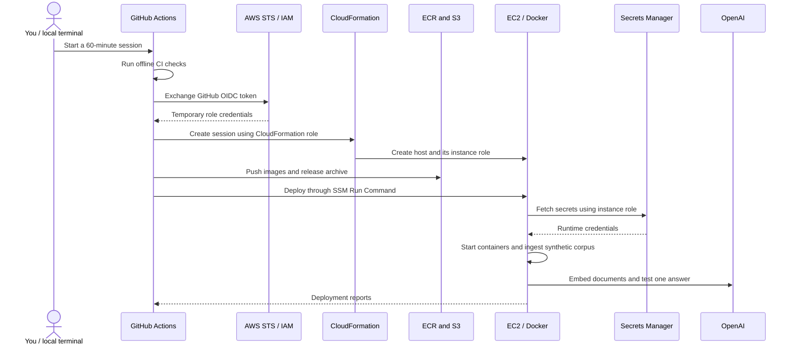

# How GitHub CI/CD connects to your AWS lab

> Monitoring now uses the [Datadog AWS runbook](../../app/observability/README.md).
> The API sends traces, custom metrics and evaluations directly; CloudWatch logs use the Forwarder.
> Start and Destroy own the application, session Forwarder and CloudWatch logs together.
> Configure `DATADOG_API_KEY_SECRET_ARN`, `DD_SITE`, and `DD_LLMOBS_ML_APP` for GitHub AWS sessions.

For copyable operating steps, see the [start, browser and delete guide](START_USE_DELETE_GUIDE.md).

GitHub checks and packages your code. AWS runs the application. OpenAI supplies
the LLM and embeddings. Your laptop sends commands and opens the application's
UI through an authenticated tunnel.

This guide explains the implementation in this repository. For setup, access
commands and full cleanup instructions, use the [AWS lab runbook](README.md).

## 1. CI and CD do different jobs

**Continuous integration (CI)** checks whether a code change passes the project's
automated checks. **Continuous delivery (CD)** prepares and deploys a chosen
version of the application. Our deployment is manually triggered so a normal
code push does not start a paid AWS session.

| Workflow | Trigger | What happens | Needs your AWS credentials? |
| --- | --- | --- | --- |
| [Application checks](../../.github/workflows/ci.yaml) | Pull request, push to `main`, or called by deployment | Install locked dependencies; lint; check types; run offline tests; validate CloudFormation, shell and both Compose profiles | No |
| [Disposable AWS lab](../../.github/workflows/aws-lab.yaml) | Manual `start`, `deploy`, `evaluate`, `capacity` or `destroy` | Run the selected operation using temporary AWS credentials | AWS role access through OIDC; no stored AWS access keys |

For example, fixing a Python file and pushing it runs CI. It does not change a
running lab. To release the change, run `deploy` against an existing session, or
`start` for a new session. The `start` and `deploy` operations run CI first and
proceed only if it succeeds. Each run uses its selected Git commit.

[GitHub workflow concepts](https://docs.github.com/en/actions/concepts/workflows-and-actions/workflows).

## 2. What happens when you select start



The pipeline builds three Linux images: application, LiteLLM gateway and
Guardrails validator. ECR stores them; the release references immutable image
digests. S3 holds the release archive and synthetic corpus. SSM tells the host
to fetch and verify the archive, configure Docker, initialize the database,
ingest documents and test readiness plus one cited answer.

The OpenAI calls happen on the AWS host during ingestion and the application
smoke test. CI uses offline fakes and placeholder credentials. A separate
`evaluate` operation runs one paid golden-case evaluation; ordinary deployment
does not run that evaluation.

## 3. Why we created the AWS identities

The bootstrap stack, `nexa-ci-bootstrap`, establishes permission to create later
lab sessions. It contains two roles, a managed permissions-boundary policy and,
when not already present, the GitHub OIDC identity provider.

| Identity or policy | Purpose | Used by |
| --- | --- | --- |
| GitHub OIDC provider | Lets AWS verify GitHub-issued identity tokens | AWS IAM / STS |
| `GitHubRole` | Allows the workflow to request lab creation/deletion, push images, upload releases and send SSM commands | GitHub Actions runner |
| `CloudFormationRole` | Creates and deletes the network, EC2, storage, logs, IAM and cleanup resources described in the session template | CloudFormation |
| `SessionBoundary` | Sets the maximum permissions available to session-created roles; it does not grant permissions by itself | Roles created for the session |
| EC2 instance role | Lets the host pull images, fetch its secrets, use SSM and publish reports/logs | AWS host; created per session |

Your human IAM administrator creates the bootstrap once. Later, the workflow
uses its more limited GitHub role. The template's `iam:PassRole` permission lets
the workflow tell CloudFormation which execution role to use; it does not give
the workflow that role's credentials.

OIDC means GitHub supplies a signed identity token, and AWS verifies its issuer,
audience and repository/environment subject before issuing temporary
credentials. The `aws-lab` GitHub environment is restricted to `main`. The
bootstrap remains privileged enough to provision infrastructure, so trusted
maintainers must control workflow edits and environment settings.

[GitHub's AWS OIDC documentation](https://docs.github.com/en/actions/how-tos/secure-your-work/security-harden-deployments/oidc-in-aws).

## 4. An ARN is an address; a secret is a credential

An Amazon Resource Name (ARN) identifies a resource. Knowing a role or secret
ARN does not grant permission to use it. AWS still checks the caller's identity
and policies.

The CloudFormation output **key** names a result; the output **value** contains
the actual ARN. For example, `GitHubRoleArn` is an output key, while
`arn:aws:iam::ACCOUNT_ID:role/GENERATED_ROLE_NAME` illustrates its value.

| Configuration | Where it belongs | What it contains |
| --- | --- | --- |
| `AWS_REGION` | GitHub environment variable in `aws-lab` | `ap-south-1` |
| `AWS_GITHUB_ROLE_ARN` | GitHub environment variable in `aws-lab` | Value of bootstrap output `GitHubRoleArn` |
| `AWS_CLOUDFORMATION_ROLE_ARN` | GitHub environment variable in `aws-lab` | Value of bootstrap output `CloudFormationRoleArn` |
| `AWS_SESSION_BOUNDARY_ARN` | GitHub environment variable in `aws-lab` | Value of bootstrap output `BoundaryArn`; this is a policy ARN |
| `OPENAI_API_KEY_SECRET_ARN` | GitHub environment variable in `aws-lab` | Full Mumbai ARN of `nexa-lab-openai` |
| `DATADOG_API_KEY_SECRET_ARN` | GitHub environment variable in `aws-lab` | Full same-Region ARN of `nexa-lab-datadog`; never the key value |
| `DD_SITE`, `DD_LLMOBS_ML_APP` | GitHub environment variables in `aws-lab` | Datadog site and application name; this setup uses `datadoghq.com`, `nexaassist` |
| `AWS_UI_ALLOWED_CIDR` | GitHub **environment secret** in `aws-lab` | Trainer public IPv4 `/32`; saved once for automatic UI access |
| Actual OpenAI API key | AWS Secrets Manager, secret named `nexa-lab-openai` | Only the API key in plaintext, without an environment-variable prefix or JSON wrapper |
| Actual Datadog API key | AWS Secrets Manager, secret named `nexa-lab-datadog` | Only the API key in plaintext; the account connection stays reusable |
| Database password, gateway key, reviewer token | Generated session secret in Secrets Manager | Random session-specific credential material |
| AWS access key / secret access key | Not required in GitHub for this pipeline | OIDC supplies temporary credentials instead |

The variables in GitHub tell the workflow **where to go and which roles to use**.
They are configuration, not secret values. Do not put an OpenAI API key into a
GitHub variable ending in `_ARN`. The saved IP is a network allowlist, not a
credential. GitHub masks it in logs, but authorized AWS readers can see it in
CloudFormation and the EC2 security-group rule.

During deployment, [host.sh](host.sh) fetches the OpenAI key with the EC2 role.
It writes a root-private runtime `.env` with mode `0600`, deletes temporary
secret files and passes the actual OpenAI key only to LiteLLM. The API receives
the gateway credential. The release archive contains the secret ARN, not its
value. Local `.env` files are not uploaded.

The lab retrieves secrets directly through the AWS CLI. The optional AWS
Workload Credentials Provider and its localhost endpoint are not installed or
needed by this implementation. Updating a secret does not automatically refresh
already-running containers; redeploy the session to load the new value.

[AWS secret retrieval documentation](https://docs.aws.amazon.com/secretsmanager/latest/userguide/retrieving-secrets.html).

## 5. Why these services are used

| Service | Job in this lab |
| --- | --- |
| CloudFormation | Creates related resources as a repeatable stack and tracks their deletion |
| EC2 and encrypted EBS | Runs all Docker containers and their temporary data on one host |
| ECR | Stores the three built container images |
| S3 | Stores versioned release archives, the synthetic corpus and reports |
| Secrets Manager | Holds the OpenAI key and generated session credentials |
| Systems Manager (SSM) | Runs deployment commands and provides authenticated forwarding for backend ports and optional UI access |
| EC2 security group | Allows only UI TCP 8501 from the saved trainer `/32`; the template configures it for every fresh session |
| CloudWatch Logs | Collects container logs for troubleshooting |
| EventBridge Scheduler and Lambda | Runs expiry cleanup and requests deletion of the session stack |
| IAM and STS | Control permissions and issue temporary AWS credentials |
| OpenAI | Supplies chat, judge and `text-embedding-3-small` embeddings through LiteLLM |

PostgreSQL/pgvector, LiteLLM and Guardrails AI run as containers on EC2. Datadog
receives agentless traces/evaluations and logs from the session-owned Forwarder.
This lab does not use managed RDS, OpenSearch, SageMaker or Kubernetes. The
single-host layout keeps a short training session easier to create and delete;
it is not a production high-availability design.

Bedrock, including Bedrock Guardrails, is disabled by default. To use it later,
follow the [explicit Bedrock setup](README.md#optional-bedrock-mode--disabled-by-default)
and create a new session with the separate embedding profile.

## 6. Operate the AWS lab from your laptop

These commands trigger work on GitHub's runner; your laptop does not need to
build images or hold AWS access keys for these workflow operations. Install
[GitHub CLI](https://cli.github.com/) if `gh` is unavailable, then authenticate:

```bash
gh auth login
```

Start a new session only when that session name is not already in use:

```bash
gh workflow run aws-lab.yaml \
  --repo pankajshakya627/LLMOps --ref main \
  -f operation=start -f session=nexa-lab-training \
  -f model_provider=openai -f minutes=60 -f budget=5
```

Find the run and monitor it. Replace `RUN_ID` with the numeric ID in the list:

```bash
gh run list --repo pankajshakya627/LLMOps --workflow aws-lab.yaml --limit 5
gh run watch RUN_ID --repo pankajshakya627/LLMOps --exit-status
```

After changing and pushing code, update the existing session:

```bash
gh workflow run aws-lab.yaml \
  --repo pankajshakya627/LLMOps --ref main \
  -f operation=deploy -f session=nexa-lab-training \
  -f model_provider=openai
```

Redeployment does not extend the original expiry. To delete the session:

```bash
gh workflow run aws-lab.yaml \
  --repo pankajshakya627/LLMOps --ref main \
  -f operation=destroy -f session=nexa-lab-training
```

To inspect current host and container memory without creating resources or
calling models, run the workflow with `operation=capacity` and the same session
name, then read that run's output. The snapshot does not establish peak-load capacity.

Watch the destroy run to completion too. All five operations can also be run
through GitHub **Actions → Disposable AWS lab → Run workflow**. Destroy deletes
the session's database, reports, Forwarder and CloudWatch logs. Exported Datadog
history and reusable account credentials follow their own lifecycle.

After successful deployment, open **Actions → your run → Summary → Open the
application**. The URL includes `:8501`; both the UI binding and restricted
firewall rule are created automatically on fresh sessions. Complete the
[one-time bootstrap update and saved IP setup](README.md#enable-automatic-browser-access-once)
first. Only CloudFormation's role receives the scoped ingress permissions;
GitHub's role and the instance role do not.

Use the [browser guide](START_USE_DELETE_GUIDE.md#2-open-the-application-and-datadog).
Direct access uses HTTP and synthetic data only. A changed public IP requires
refreshing the saved secret before the next fresh session. For the current
session, use an SSM tunnel to `http://127.0.0.1:18501`; FastAPI also uses SSM forwarding; open Datadog directly from the run summary. Your laptop needs its own AWS login and Session Manager
plugin for these tunnels. GitHub authentication does not sign your laptop in.
Older private-template stacks must be finished/destroyed and recreated before
using the new automatic direct-access deployment.

## 7. Cost, deletion and what success means

The session timer starts at infrastructure creation, so builds and deployment
consume part of the selected 60 or 120 minutes. Scheduled cleanup removes the
session stack. An independent host shutdown timer terminates EC2 if scheduled
cleanup fails, but does not prove every other resource was removed.

The `budget=5` input is a planning tag, not a $5 spending cutoff. AWS
infrastructure and OpenAI usage are billed separately. Check deletion completes
and inspect failures rather than relying on the timer alone.

| Resource group | After session destroy |
| --- | --- |
| Session EC2/EBS, ECR images, session S3 objects/versions, runtime secret, logs and other stack resources | Removed when cleanup succeeds |
| Bootstrap IAM roles, boundary and OIDC provider created by the bootstrap | Retained for later sessions; bootstrap deletion is separate |
| Reusable `nexa-lab-openai` secret | Retained and still billed for storage; delete separately if no longer needed |
| OpenAI API key itself | Remains valid until revoked in OpenAI |
| Local source, local Docker data and GitHub run history | Retained |

Green CI proves the offline checks passed. Successful AWS authentication proves
the OIDC trust worked. A successful deployment additionally requires stack
creation, image builds, secret retrieval, ingestion and the live answer smoke.
Successful teardown requires confirmed deletion, not just a successful start.

If a run fails, open its failed step and inspect the error. Common boundaries:

| Failed step | Check |
| --- | --- |
| Preflight | Set `AWS_UI_ALLOWED_CIDR` in the `aws-lab` environment secrets for start |
| Configure AWS credentials | Actual role ARN, exact OIDC subject and environment/branch restriction |
| Create infrastructure | CloudFormation Events and the first resource failure reason; a Free Tier eligibility error requires an account-eligible instance, not broader IAM permissions |
| Build/push images | Docker build log and ECR permissions |
| Deploy/ingest/smoke | SSM Run Command, host startup logs, secret format/access and OpenAI model availability |
| Destroy | CloudFormation Events and remaining resources; retry after correcting the reported issue |

The full [runbook](README.md) contains the setup parameters, access commands,
cost qualifications and cleanup procedures. [Validation evidence](VALIDATION.md)
records the checks performed; a prepared template alone is not evidence that a
live deployment or timed deletion has succeeded.
