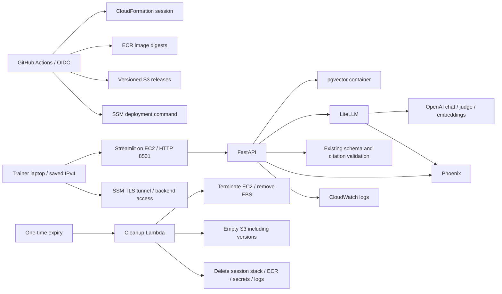

# Disposable AWS LLMOps lab

> Monitoring now uses the [Datadog AWS runbook](../../app/observability/README.md).
> The API sends traces, custom metrics and evaluations directly; CloudWatch logs use the Forwarder.
> The old Phoenix viewing instructions below are historical and no longer apply.
> Configure `DATADOG_API_KEY_SECRET_ARN`, `DD_SITE`, and `DD_LLMOBS_ML_APP` for GitHub AWS sessions.

For a step-by-step session, use the [start, browser and delete guide](START_USE_DELETE_GUIDE.md).

This deployment is designed for **one or two hours**, followed by deletion, with a
**$3–$8 planning allowance per session**. It deploys the actual application and its
supporting containers. The first successful live deployment completed on
31 October 2026; see [verification evidence](VALIDATION.md) for its checks and limits.

Use a dedicated AWS sandbox account. The selected Region is **Mumbai
(`ap-south-1`)**. The default model provider is **OpenAI** for chat, judging and
embeddings. The default deployment neither provisions nor invokes Bedrock,
including Bedrock Guardrails. Bedrock is an explicit alternative described below.

## What runs where

| Application responsibility | Placement |
| --- | --- |
| FastAPI, Streamlit, LiteLLM, Guardrails AI | One `m7i-flex.large` EC2 host (8 GiB), existing Docker images |
| Chat and independent judge alias | OpenAI through LiteLLM; existing project default `gpt-6-luna` |
| Embeddings | OpenAI `text-embedding-3-small`, 1536 dimensions |
| Input/output content policy | Existing redaction, Guardrails AI, schema and citation validation |
| Vectors, corpus metadata and feedback | Existing PostgreSQL/pgvector container, encrypted session EBS |
| LLM spans and Ragas annotations | Existing Phoenix container, session EBS |
| Immutable app/gateway/validator images | Three session-owned ECR repositories |
| Synthetic corpus, release manifests and reports | Private, encrypted, versioned S3 session bucket |
| Runtime secret material and OpenAI key | Secrets Manager; fetched by the host's instance role |
| Container logs | CloudWatch Logs; basic EC2 metrics remain available |
| Browser access | TCP 8501 restricted to the saved trainer IPv4 `/32`; URL printed after deployment |
| API/Phoenix access | SSM port forwarding; backend ports stay private |
| Build/test/deploy/evaluate/delete | GitHub Actions using OIDC |
| Expiry | EventBridge Scheduler → cleanup Lambda → stack deletion |



We deliberately omit ECS/EKS, ALB, NAT Gateway, RDS/Aurora, OpenSearch, SageMaker
endpoints and managed knowledge bases from this short lab. They add setup or
operating overhead without improving the core exercises. OpenAI replaces the
local Ollama model server for this cloud profile. The earlier [optional Bedrock design](../../app/operations/AWS_DEPLOYMENT.md)
remains a separate option for a persistent application; it is not this lab's
implementation. No production availability, separate container identities or
tenant isolation is claimed by this single-host deployment.

Read the [CI/CD explanation and local terminal guide](CI_CD_GUIDE.md) for how
GitHub connects to AWS, what each role does and where credentials belong.

## Cost envelope and limits

Plan roughly **$0.40–$1 for the host, disk, public IPv4, logs and small artifact
storage over two hours**, then reserve the remaining allowance for OpenAI chat,
embeddings and any explicitly requested Ragas evaluation. OpenAI usage is billed
by OpenAI separately from AWS; include both in the $3–$8 allowance. This
is an estimate for a small synthetic exercise, not an AWS quote or a guarantee.
Region, model, request counts, first-pull traffic, taxes and GitHub Actions usage
can change it. Verify Mumbai instance pricing, account credits and IPv4 charges
before launch. Free Tier eligibility does not mean unlimited free usage.
[EC2 pricing](https://aws.amazon.com/ec2/pricing/on-demand/),
[IPv4 pricing](https://aws.amazon.com/vpc/pricing/),
[OpenAI prices](https://openai.com/api/pricing/).

Cost controls implemented here:

- Session lifetime is 60 or 120 minutes, measured from infrastructure creation;
  builds and deployment consume part of that time. Redeploy does not extend it.
- Independent OS shutdown terminates the instance if scheduled cleanup fails.
- The host uses an x86 `m7i-flex.large`; no T3 CPU-credit configuration is applied.
- Output is bounded to 2,000 tokens, retries are bounded, and the API allows three
  answer requests per client address per minute. The UI shares its backend
  address, so this limit is shared by UI users.
- Live sampled judging, application fallback, caching and reranking are disabled.
- Startup runs one live structured-answer smoke. Ragas runs **one golden case**
  only when the separate `evaluate` operation is requested.
- The default host role and bootstrap boundary grant no Bedrock permissions.
  Only the opt-in Bedrock profile grants invocation on its approved model ARNs.

`budget` is a planning tag, **not a hard spending limit**. AWS Budgets updates
typically lag by 8–12 hours, so it cannot reliably stop a two-hour session at a
specific dollar amount. An expensive model, repeated evaluations or failed
cleanup can exceed $8. Choose a low-cost approved chat/judge model, keep testing
small and use `destroy` when finished. An account-level budget alert is useful
as an additional signal, but this deployment does not create one.
[AWS Budgets update frequency](https://docs.aws.amazon.com/cost-management/latest/userguide/budgets-managing-costs.html).

## One-time AWS and GitHub setup

Check your account plan before starting. The first live attempt failed because
the former `t3.xlarge` host was rejected as not Free Tier eligible. The default
is now `m7i-flex.large`, which AWS lists as eligible for accounts created on or
after 15 July 2025 and offers in Mumbai. Account restrictions, quotas, available
capacity and AMI eligibility still need live verification. Keep the Free account
plan; no plan upgrade is requested by this deployment.
[EC2 Free Tier eligibility](https://docs.aws.amazon.com/AWSEC2/latest/UserGuide/ec2-free-tier-usage.html),
[Regional instance families](https://docs.aws.amazon.com/ec2/latest/instancetypes/ec2-instance-regions.html).

The 8 GiB host has less memory than the previous 16 GiB default. Deployment checks
container health, ingests the corpus and tests one cited answer. It saves memory
snapshots before ingestion and after the smoke, plus per-container memory usage,
in the session's S3 report prefix. These measurements do not establish peak-load
capacity. Do not substitute a micro instance for the full stack without testing.
After deployment, run the workflow with `operation=capacity` to print a fresh
host/container memory snapshot. This operation performs no deployment or model
calls and uses the same authenticated SSM path.

1. Install AWS CLI v2 and the Session Manager plugin on the trainer's laptop.
   For the IAM admin user, use the browser login below; Identity Center users can
   instead configure an SSO profile. Verify the identity with
   `aws sts get-caller-identity`. The source repository is
   [pankajshakya627/LLMOps](https://github.com/pankajshakya627/LLMOps); the workflows
   use its `main` branch.
2. In that repository create the **`aws-lab` GitHub environment**. Restrict it to
   the default branch and trusted maintainers. Configure required reviewers if
   available on your GitHub plan. Set the required environment variables listed
   below. Do not add static AWS access keys to GitHub.
3. Determine your repository's exact GitHub OIDC subject. A legacy subject is
   `repo:OWNER/REPOSITORY:environment:aws-lab`; newer repositories may include
   immutable owner/repository IDs. Use the actual subject rather than guessing.
   This repository was created on 31 October 2026 with owner ID `39346757` and
   repository ID `1440507936`. Its expected default subject for this environment
   is `repo:pankajshakya627@39346757/LLMOps@1440507936:environment:aws-lab`.
   Verify the subject if you customize the repository's OIDC settings.
   [GitHub AWS OIDC setup](https://docs.github.com/en/actions/how-tos/secure-your-work/security-harden-deployments/oidc-in-aws).
4. Deploy the bootstrap as an administrator. It creates the GitHub role,
   CloudFormation execution role and a permissions boundary for session roles.
   If your account already has GitHub's OIDC provider, pass its ARN using
   `ExistingOidcProviderArn`; do not try to create a duplicate provider.

For the IAM user, AWS CLI **2.32.0 or later** supports console-based browser
authentication and temporary credentials. Sign in as the IAM user and complete
MFA in the browser. The identity needs `SignInLocalDevelopmentAccess` permissions;
the `AdministratorAccess` policy described for this bootstrap identity includes
those permissions. This login does not require creating a long-term access key.
[AWS CLI browser login](https://docs.aws.amazon.com/cli/latest/userguide/cli-configure-sign-in.html).

```bash
aws configure set region ap-south-1 --profile nexa-lab
aws login --profile nexa-lab
aws sts get-caller-identity --profile nexa-lab
```

Confirm the returned account is the sandbox account and the principal is your
intended IAM identity. Then use that authenticated profile for the bootstrap:

```bash
export AWS_PROFILE=nexa-lab
export AWS_DEFAULT_REGION=ap-south-1
aws cloudformation deploy \
  --stack-name nexa-ci-bootstrap \
  --template-file infra/aws/github-oidc.yaml \
  --capabilities CAPABILITY_IAM \
  --parameter-overrides GitHubSubject='repo:pankajshakya627@39346757/LLMOps@1440507936:environment:aws-lab' EnableBedrock=false
aws cloudformation describe-stacks --stack-name nexa-ci-bootstrap \
  --query 'Stacks[0].Outputs' --output table
```

### Enable automatic browser access once

For an **existing bootstrap**, apply the updated template once from the repository
root. Preserve every parameter, including the empty `ExistingOidcProviderArn`
when this stack owns the OIDC provider:

```bash
aws cloudformation update-stack \
  --profile nexa-lab --region ap-south-1 \
  --stack-name nexa-ci-bootstrap \
  --template-body file://infra/aws/github-oidc.yaml \
  --capabilities CAPABILITY_IAM \
  --parameters ParameterKey=GitHubSubject,UsePreviousValue=true \
    ParameterKey=ExistingOidcProviderArn,UsePreviousValue=true \
    ParameterKey=EnableBedrock,UsePreviousValue=true
aws cloudformation wait stack-update-complete \
  --profile nexa-lab --region ap-south-1 --stack-name nexa-ci-bootstrap
```

If AWS reports “No updates are to be performed”, this update is already applied.
The added permissions let only the CloudFormation execution role authorize and
revoke ingress on security groups tagged `Session=nexa-lab-*` in this account
and Region. The session template opens only TCP 8501 from the saved `/32`.

Save your trainer laptop's public IPv4 once as the **environment secret**
`AWS_UI_ALLOWED_CIDR` in GitHub → Settings → Environments → `aws-lab`. This is a
network allowlist, not an AWS credential; a secret keeps it masked in CI logs.
Authorized AWS readers can still see the address in stack parameters/outputs
and the security-group rule.
Alternatively run this on the trainer's Mac, from any directory:

```bash
python3 - <<'PY'
import ipaddress
import subprocess
import urllib.request

address = ipaddress.IPv4Address(
    urllib.request.urlopen('https://checkip.amazonaws.com', timeout=10).read().decode().strip()
)
if not address.is_global or address.is_multicast:
    raise SystemExit('Expected a global public IPv4 address')
subprocess.run(
    ['gh', 'secret', 'set', 'AWS_UI_ALLOWED_CIDR', '--env', 'aws-lab',
     '--repo', 'pankajshakya627/LLMOps'],
    input=f'{address}/32', text=True, check=True,
)
print('Saved the trainer IPv4 /32; future sessions enable UI port 8501 automatically.')
PY
```

Run this through the same network/VPN that your browser will use. A changed
public IP requires refreshing the saved secret **before a new session**. Each
session keeps its original allowlist; changing the secret or redeploying code
does not edit an existing security group. Use SSM forwarding if your IP changes
mid-session. A shared public IP allows others behind that same network exit;
it is not application authentication.

The execution role is intentionally privileged to create/delete the lab's
network, compute and IAM resources. Some EC2 provisioning actions need wildcard
resource scope. IAM role creation is restricted to the `nexa-lab-` prefix and
the bootstrap's fixed permissions boundary. Review this template and use a
sandbox account; the boundary is not a substitute for controlling who may edit
or run deployment workflows.

| GitHub environment variable | Value |
| --- | --- |
| `AWS_REGION` | `ap-south-1` (also the workflow default) |
| `AWS_GITHUB_ROLE_ARN` | Bootstrap output `GitHubRoleArn` |
| `AWS_CLOUDFORMATION_ROLE_ARN` | Bootstrap output `CloudFormationRoleArn` |
| `AWS_SESSION_BOUNDARY_ARN` | Bootstrap output `BoundaryArn` |
| `OPENAI_API_KEY_SECRET_ARN` | ARN of the existing plaintext secret `nexa-lab-openai` in this account and Region |
| `OPENAI_LITELLM_CHAT_MODEL` | Optional; defaults to `openai/gpt-6-luna` |
| `OPENAI_LITELLM_JUDGE_MODEL` | Optional independent judge route; defaults to `openai/gpt-6-luna` |

Create the **OpenAI credential** in the AWS Secrets Manager console: choose
“Other type of secret”, the **Plaintext** editor, and paste only the OpenAI API
key, without a JSON wrapper. Name it **`nexa-lab-openai`**, choose the default
AWS-managed `aws/secretsmanager` encryption key, and create it in `ap-south-1`.
Put its **ARN**, not the API key, in the GitHub variable above. Customer-managed
KMS keys require additional reviewed decrypt permissions and are not configured
by this lab. Missing, inaccessible or malformed credentials stop deployment;
there is no fallback to Bedrock.

The release archive contains only the secret ARN. The EC2 host retrieves the
key into a root-private `.env`; only the gateway receives it as its OpenAI key.
The API receives gateway credentials. Never place the raw key in GitHub variables,
workflow inputs, source code, release manifests or shell command arguments.
The reusable credential secret is not owned by the session stack and persists
until you delete it separately; its storage is billed even between sessions.

The cloud profile uses `litellm_openai.yaml`, `nexa-chat-openai`,
`nexa-judge-openai` and `nexa-embed-openai`. Query and evaluation embeddings both
use 1536-dimensional `text-embedding-3-small` with
`EMBEDDING_PROFILE=openai-3-small-gateway-v1`, and separate
`lab_chunks_openai_v1` / `lab_parents_openai_v1` namespaces. Ingestion and query
must use that same identity. The existing local Compose lab is unchanged.
[OpenAI embeddings](https://developers.openai.com/api/docs/models/text-embedding-3-small),
[LiteLLM OpenAI routing](https://docs.litellm.ai/docs/providers/openai).

## Optional Bedrock mode — disabled by default

Use this section only when you explicitly want Bedrock instead of OpenAI.
Destroy the current session first and use a new session name: changing providers
within a session is rejected before building a deployment or uploading a release.
An existing stack without a `ModelProvider` output is treated as legacy Bedrock.
OpenAI and Titan vectors are incompatible, including models with equal dimensions.

1. Reapply the bootstrap template using the same OIDC subject and any existing
   provider ARN, replacing `EnableBedrock=false` with **`EnableBedrock=true`**. Without
   this change the role boundary and provisioner cannot use Bedrock.
2. Add these GitHub `aws-lab` environment variables:

| Optional Bedrock variable | Value |
| --- | --- |
| `BEDROCK_CHAT_ROUTE` | `bedrock/converse/` followed by an approved model/profile ID |
| `BEDROCK_JUDGE_ROUTE` | Explicit judge route, which may initially match chat |
| `BEDROCK_MODEL_ARNS` | Exact model/profile ARNs, including Titan and cross-Region destination models |

3. Run **start** with **`model_provider=bedrock`** and a new session name. Use the
   same provider for later **deploy** operations. The release then adds
   `compose.aws.bedrock.yaml`, selects `litellm_bedrock.yaml`, creates a published
   Bedrock guardrail, and grants the scoped runtime permissions. It never reads
   the OpenAI key or routes through OpenAI. Evaluation uses the Bedrock judge and
   embedding aliases too. To restore the default bootstrap permissions, remove
   all Bedrock sessions and reapply the bootstrap with `EnableBedrock=false`.

Titan's foundation model ARN has the form
`arn:aws:bedrock:REGION::foundation-model/amazon.titan-embed-text-v2:0`.
An inference-profile ARN includes your account ID; its destination foundation
model ARNs must also be authorized. Confirm model access/marketplace terms and
quotas in the console before running the workflow. No models are auto-subscribed.

Choose a model/route supported by the pinned LiteLLM **1.106.2** and the app's
strict `AnswerDraft` JSON schema. A cheap model that returns plain text is not a
working replacement. AWS specifically documents that Haiku 4.5 structured output
is not supported through the India `in.anthropic` inference profile. Do not assume
Mumbai is suitable for every candidate; choose a supported model/Region/profile
and respect data residency. Bedrock can take about 90 seconds to compile a new
schema, so the AWS profile uses a bounded 120-second chat timeout.
[Structured outputs and profile limitations](https://docs.aws.amazon.com/bedrock/latest/userguide/structured-output.html),
[LiteLLM Bedrock routing](https://docs.litellm.ai/docs/providers/bedrock),
[Titan dimensions](https://docs.aws.amazon.com/bedrock/latest/userguide/titan-embedding-models.html).

## Start and use a session

In GitHub **Actions → Disposable AWS lab → Run workflow**, choose:

- `operation`: **start**
- `model_provider`: **openai** (default)
- `session`: e.g. **nexa-lab-training** (a fresh stack name)
- `minutes`: **60** or **120**
- `budget`: your **3–8** USD planning allowance

The workflow runs lint, types, tests and template checks, creates infrastructure,
builds all three images on Linux/amd64, pins their ECR digests, packages only the
registered synthetic corpus, and delivers the checksummed archive through S3.
SSM fetches the runtime secret without putting it in command arguments or CI
logs. It initializes pgvector, re-ingests the eight source documents into new
OpenAI namespaces, starts the application and checks readiness plus one cited
structured answer. Local Docker services, databases and `.env` are untouched.

After a successful deployment, open **Actions → your run → Summary → Open the
application**. The URL is `http://CURRENT_PUBLIC_IP:8501`; the port is configured
automatically for each fresh session. You can also fetch it directly:

```bash
aws cloudformation describe-stacks --stack-name nexa-lab-training \
  --profile nexa-lab --region ap-south-1 \
  --query "Stacks[0].Outputs[?OutputKey=='ApplicationUrl'].OutputValue | [0]" --output text
```

Use synthetic data only: direct browser access uses HTTP without a login or TLS.
For an authenticated tunnel, find the host ID in CloudFormation stack outputs:

```bash
aws cloudformation describe-stacks --stack-name nexa-lab-training \
  --profile nexa-lab --region ap-south-1 \
  --query "Stacks[0].Outputs[?OutputKey=='InstanceId'].OutputValue" --output text
aws ssm start-session --target i-your-instance-id \
  --profile nexa-lab --region ap-south-1 \
  --document-name AWS-StartPortForwardingSession \
  --parameters '{"portNumber":["8501"],"localPortNumber":["18501"]}'
```

Open [the forwarded UI](http://127.0.0.1:18501). The browser's loopback HTTP
connection travels over SSM's authenticated TLS tunnel. For FastAPI docs use a
second tunnel with remote port `8000` and local port `18000`; for Phoenix use
remote `6006`, local `16006`. Your human AWS identity needs permission to start,
resume and terminate sessions against this host and use the forwarding document.
The CI role intentionally has no interactive session access.
[SSM forwarding requirements](https://docs.aws.amazon.com/systems-manager/latest/userguide/session-manager-working-with-sessions-start.html).

If `TargetNotConnected` appears, check that the target is the current session's
instance and is both EC2 `running` and SSM `Online`. A failed start automatically
deletes its host; an old terminated instance ID cannot be reused. Fix the startup
error and create a new session, then copy its new `InstanceId`. Also install the
local Session Manager plugin before opening a tunnel; AWS CLI login alone does
not install that plugin.

### Automatic direct access from one IP

The AWS Compose profile publishes only the UI on `0.0.0.0:8501:8501`.
CloudFormation creates the matching TCP 8501 rule from `AWS_UI_ALLOWED_CIDR`.
API and Phoenix bindings remain on loopback; database, gateway and validator
ports are not published. No per-session port mapping or console rule is needed.
Destroy removes the ingress rule and its security group with the session.

Existing stacks created with the old private template remain unchanged. A
deployment to one of those stacks stops before image builds or release upload;
finish the session, destroy it and start fresh with the new template. Status,
capacity and destroy remain usable for those older stacks. This change does
not extend any session's expiry.

Use only synthetic material. Phoenix and the API have no public listener, and
SSM access is an administrative boundary. All containers share one EC2 IAM role;
this is not suitable for untrusted users or private bank documents. OpenAI's
processing location is independent of the EC2 Region. In optional Bedrock
mode, its check blocks on intervention, malformed responses or outage. Existing redaction,
schema, quote membership, access-scope and citation checks remain active. Retrieved
document injection is still governed by the existing prompt controls; the optional
Bedrock input check evaluates the sanitized user query, not every retrieved PDF.

## CI/CD, evaluation and rollback

`ci.yaml` runs on pull requests and pushes to `main` and is reused before paid
deployments. It makes no live LLM calls. `aws-lab.yaml` is manual so every push
does not create a paid environment.

`deploy` builds a new immutable release in an existing session without resetting
its expiry. If health or answer smoke checks fail, the host attempts to restore
the previous release's image/configuration. It does not roll back corpus writes;
the supplied corpus and schema are fixed synthetic lab fixtures. A failed first
deployment stops API/UI, and the `start` workflow requests full session cleanup.
Duplicate `start` on a live name fails without deleting that existing stack.

`evaluate` uses the current deployed image and one frozen golden case. A failing
metric gate fails the workflow and still saves its JSON report in the session S3
bucket. The existing gates remain **placeholder** course thresholds. One case,
or a same-model judge, is not production quality approval. Before production,
confirm/calibrate thresholds, freeze a larger dataset and judge, add regression
comparison and enforce release gates before accepting traffic.

After a successful deploy, inspect `/metrics/http`, `/metrics/answers`,
`/metrics/latency`, Phoenix traces and Ragas annotations. The AWS synthetic lab
enables `PHOENIX_CAPTURE_CONTENT=true`: new API/chain/model spans show bounded
inputs and results while supported PII/common credential fields remain masked.
Set this back to false before using real/confidential data. Gateway raw message
capture remains disabled; application model spans show messages in the training
project. See the [viewing guide](START_USE_DELETE_GUIDE.md#7-view-complete-synthetic-traces-and-api-monitoring).
Gateway mixed-route dollar cost remains
null in the application's metrics; use OpenAI usage/billing for model cost and
AWS billing for infrastructure (Bedrock usage applies only in that optional mode).
CloudWatch logs live at `/nexaassist/SESSION`. SSM command history and GitHub run
history provide deployment receipts; SSM port-forwarded traffic itself is not
session-content logged. Account-owned CloudTrail or organization audit trails
are not altered by lab teardown.

## Delete everything belonging to the session

Run the workflow with `operation=destroy` and the exact session name. The command
waits for CloudFormation deletion and fails on incomplete cleanup. Automatic
expiry executes the same cleanup Lambda: terminate the host, empty S3 object
versions/delete markers and unfinished uploads, then delete the stack using its
saved CloudFormation role. ECR repositories force-delete their images. The EBS
disk, pgvector data, feedback, Phoenix traces, reports, secret and session logs
are disposable and are deleted. Download any synthetic report you want to keep
**before** destruction.

The scheduler can run up to roughly a minute after its scheduled time; retries
and stack deletion take additional time. The shutdown timer is a fallback for
compute, not proof that every resource was deleted. Always verify:

```bash
aws cloudformation describe-stack-events --stack-name nexa-lab-training \
  --query 'StackEvents[0:10].[LogicalResourceId,ResourceStatus,ResourceStatusReason]' \
  --output table
```

Expected: `DELETE_COMPLETE` (or the named stack no longer exists). If you see
`DELETE_FAILED`, inspect the named resource, fix the permission/active-writer
problem and retry deletion. Do not leave a failed stack assuming expiry solved
it. If instance startup failed, check `/var/log/cloud-init-output.log` through
SSM. If an application command failed, inspect SSM Run Command and CloudWatch.

The **bootstrap** deliberately retains only IAM roles/policies/OIDC identity for
repeat deployments; it has no hourly compute or storage. To remove even that,
first verify all `nexa-lab-*` stacks are gone, then:

```bash
aws cloudformation delete-stack --stack-name nexa-ci-bootstrap
aws cloudformation wait stack-delete-complete --stack-name nexa-ci-bootstrap
```

If the bootstrap reused an existing OIDC provider, it will not delete that
account-owned provider. No unrelated resources or local source files are removed.

The reusable `nexa-lab-openai` credential secret remains outside session teardown.
To remove its paid storage too, after all OpenAI sessions are gone:

```bash
aws secretsmanager delete-secret --profile nexa-lab --region ap-south-1 \
  --secret-id nexa-lab-openai --recovery-window-in-days 7
```

Secrets marked for deletion are inaccessible and not charged during the recovery
window. On 31 October 2026 the full cost cleanup marked this secret for deletion
and removed the unused CloudFormation template-upload bucket. Before starting
another session during the recovery window, restore the secret:

```bash
aws secretsmanager restore-secret --profile nexa-lab --region ap-south-1 \
  --secret-id nexa-lab-openai
```

Restoring resumes normal secret storage billing. After permanent deletion,
recreate the plaintext secret and update its ARN in GitHub instead. Deleting the
AWS secret does not revoke the underlying OpenAI key; revoke it in OpenAI
separately if no longer used.
[AWS secret deletion and recovery](https://docs.aws.amazon.com/secretsmanager/latest/userguide/manage_delete-secret.html).

## Validation and decision evidence

See [VALIDATION.md](VALIDATION.md) for checks actually run and remaining live
gates, and [decisions.jsonl](decisions.jsonl) for the bounded architecture search.
The source inventory covered the active Python services, Dockerfiles, Compose,
configuration, ingestion, retrieval, evaluation, tests and existing AWS design.
Training decks and historical results were treated as non-runtime assets.

The invoked [ECC `repo-scan` file](/Users/pankaj/.codex/plugins/cache/ecc/ecc/2.2.3/skills/repo-scan/SKILL.md)
is an external-skill installer, not a scanner.
Its instruction says: “Installation completes only the bootstrap. Reload your
agent harness, then invoke `repo-scan` again.” It was not installed or represented
as a completed external audit; direct source inspection supplied this migration's
inventory. No external skill code was executed.
